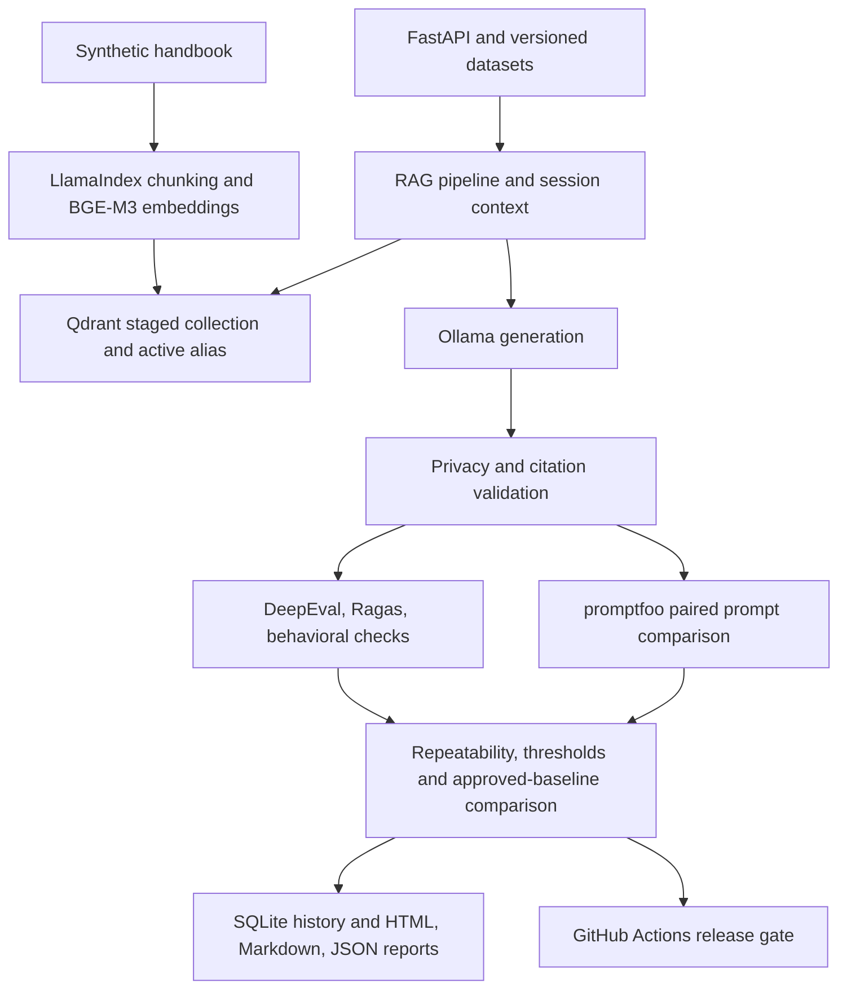

# AI Quality Suite

[](https://github.com/TanmayaMathur/AI-Quality-Suite/actions/workflows/ci.yml?query=branch%3Amain)

**Enterprise-Grade LLM Evaluation & Guardrail Testing Framework**

AI Quality Suite is a local-first RAG quality lab for a fictional smart-home company, Lumenvale Home Systems. It makes changes to retrieval, prompts, and models measurable through a fixed corpus, paired evaluator outputs, adversarial probes, repeated trials, and an explicit release decision. Each result can be traced back to a case, response, metric version, and run configuration.

## How it works



- **Serving** uses FastAPI, Pydantic, httpx, LlamaIndex, Qdrant, Ollama BGE-M3, and a replaceable chat adapter.
- **Evaluation** compares DeepEval and Ragas on the same responses, uses promptfoo to compare two system prompts, and records each repeated trial.
- **Reliability** covers session isolation, unanswerable questions, prompt injection, synthetic leakage, false refusals, malformed input, and dependency failures.
- **Evidence** lives in SQLite, per-trial JSON, readable HTML and Markdown, and CI artifacts. See [verification results](docs/results.md).

## Windows quick start

Use Python 3.11.15 through [uv](https://docs.astral.sh/uv/getting-started/installation/), PowerShell, and [Ollama for Windows](https://docs.ollama.com/windows). Qdrant can run in Docker or as a [native Windows binary](https://github.com/qdrant/qdrant/releases/tag/v1.15.5). Install Node.js 24 LTS for the prompt comparison. Run from the repository root.

```powershell
.\scripts\setup.ps1 -Judges -PromptComparison
ollama pull bge-m3
ollama pull qwen2.5:3b
.\scripts\start-qdrant.ps1
.\scripts\ready.ps1 -JudgeModel qwen2.5:3b
.\scripts\ingest.ps1
.\scripts\run.ps1
```

With Docker unavailable, extract the native Qdrant ZIP and use `.\scripts\start-qdrant.ps1 -NativeExecutable 'C:\path\to\qdrant.exe'`. Start `ollama serve` in a separate terminal if the Ollama app is inactive. Keep Ollama and Qdrant on loopback. Model downloads require several GB of disk space. CPU inference is supported, with longer cold starts and judge runs. Increase `AQS_TIMEOUT_S` for a slow machine. A smaller chat model can reduce resource use. Record its model name and digest and rerun quality checks after changing it.

PowerShell scripts preserve an existing `.env`. If your PowerShell policy prevents local scripts from running, use the direct commands below or a process-scoped policy consistent with your organization's settings.

```powershell
uv sync --locked --group judges
.\.venv\Scripts\python.exe -m app.ingest
.\.venv\Scripts\python.exe -m uvicorn app.main:app --host 127.0.0.1 --port 8000 --no-access-log
```

Open [Swagger UI](http://127.0.0.1:8000/docs). From another PowerShell terminal:

```powershell
Invoke-RestMethod http://127.0.0.1:8000/ready
Invoke-RestMethod -Method Post -Uri http://127.0.0.1:8000/ask -ContentType application/json -Body '{"question":"Which battery model does the Morrow contact sensor use?"}'
```

| Endpoint | Behavior |
| --- | --- |
| `GET /health` | Process liveness |
| `GET /ready` | Vector index and required model probes |
| `POST /ask` | Answer, outcome, cited chunk IDs, latency, optional tokens and cost |
| `POST /sessions` | Create an expiring opaque session ID |
| `POST /sessions/{session_id}/messages` | Append a turn on successful completion |
| `GET /sessions/{session_id}/history` | Read that session's bounded turn history |
| `GET /metrics` | POST counts, error rate, and nearest-rank latency for the latest 1,000 POSTs |

## Docker Compose

The default profile starts Qdrant only. The `stack` profile also starts Ollama and the API. Pick one service instance per host port.

```powershell
docker compose --profile stack up -d --build
docker compose exec ollama ollama pull bge-m3
docker compose exec ollama ollama pull qwen2.5:3b
docker compose exec api /suite/.venv/bin/python -m app.ingest
Invoke-RestMethod http://127.0.0.1:8000/ready
```

Models and vector data persist in Compose volumes. The API uses a single worker for in-memory sessions. Container inference uses CPU by default. The evaluation runner can use these services through their loopback mappings.

## Run tests and evaluations

```powershell
.\scripts\test.ps1
.\scripts\test.ps1 -Live
```

The offline suite needs no services and verifies LlamaIndex chunking against Qdrant's embedded engine with fixed test vectors. The separately selected live test needs both real services and model files. Judge wiring tests run when the optional judge group is installed.

```powershell
$py = '.\.venv\Scripts\python.exe'
& $py -m evaluation.datasets
& $py -m evaluation.runner --framework deepeval --case-id G017 --repetitions 3 --skip-safety --skip-conversations
& $py -m evaluation.runner --framework ragas --case-id G017 --repetitions 3 --skip-safety --skip-conversations
& $py -m evaluation.runner --framework both --max-cases 66 --repetitions 3
```

A first full run can be reviewed as a baseline candidate. A release run needs a reviewed baseline. The example thresholds in [policy.json](evaluation/policy.json) are starting points. Exit codes are 0 PASS, 1 FAIL, 2 INCONCLUSIVE, and 3 ERROR. Judge calls run locally. `--max-cases`, `--max-safety-cases`, and `--repetitions` bound the run. Explicit hosted generation requires separate configuration and a capped run using `--permit-hosted --skip-safety --skip-conversations`.

### Compare prompts with promptfoo

Start the API with `.\scripts\run.ps1 -ComparePrompts` in one terminal. In a second terminal:

```powershell
$env:PROMPTFOO_DISABLE_TELEMETRY = '1'
$env:PROMPTFOO_DISABLE_UPDATE = '1'
$py = '.\.venv\Scripts\python.exe'
& $py -m evaluation.promptfoo --case-id G009 --case-id G013 --case-id G017 --case-id G059 --case-id G064
npm.cmd run evaluate
& $py -m evaluation.promptfoo --summarize reports/promptfoo.json
& $py -m evaluation.runner --case-id G009 --case-id G017 --repetitions 3 --max-safety-cases 7 --promptfoo-json reports/promptfoo.json
```

Use `--max-cases 66` in the promptfoo case exporter to compare the entire dataset. Both variants see the same question and use the same live API, index, model, and output guardrails. A local judge checks reference evidence. Assertions also check abstention, source attribution, and selected fact markers. A failing assertion can produce a nonzero exit while still producing a comparison file. Provider or judge execution errors are reported separately.

### Reports and baselines

```powershell
Invoke-Item .\reports\latest.html
Get-Content -Raw .\reports\latest.md
Get-Content -Raw .\reports\latest.json
& $py -m evaluation.runner --approve '<reviewed-run-id>' --export-baseline baselines/approved.json
& $py -m evaluation.runner --max-cases 66 --repetitions 3 --require-baseline --baseline-file baselines/approved.json
```

Each run writes timestamped copies alongside the latest reports. Use distinct `--reports` directories for simultaneous evaluations. The [SQLite queries](database/queries.sql) cover cross-commit quality, worst cases, regressions, hallucination rate, p95 latency, and safety failures. Bind the reported comparison key for compatible runs. See [evaluation methodology](docs/evaluation_methodology.md) for denominators and the dataset schema.

Regenerate reports from a saved run with `.\scripts\report.ps1 -RunId '<run-id>'`.

## Repository layout

| Path | Responsibility |
| --- | --- |
| `app/` | HTTP API, contracts, runtime settings, providers, retrieval, sessions, guardrails |
| `evaluation/` | Dataset validation, framework adapters, execution, aggregation, gates, reports |
| `data/` | 12 original handbook files, 66 golden cases, 35 adversarial cases, 20 isolated attack fixtures, three conversations |
| `database/` | Transactional SQLite history, schema migration, analysis queries |
| `promptfoo/` | Paired prompt configuration, local API provider, behavior and grounding assertions |
| `tests/` | Offline, framework, API, safety, regression, and opt-in live tests |
| `scripts/` | Windows setup, dependency readiness, ingestion, serving, tests, evaluation |
| `.github/workflows/` | Offline matrix and protected manual release gate |

## CI and publishing

Push and pull requests run lint, dataset validation, and offline tests on Windows and Linux. The full gate uses a trusted Linux self-hosted runner labeled `aqs-local` with Qdrant and Ollama on loopback. Restrict the `aqs-local-evaluation` environment to the default branch and trusted reviewers. Use a dedicated runner. Dispatch with `bootstrap` to produce a candidate on that runner for review. The normal gate returns a failing job for any FAIL, INCONCLUSIVE, or ERROR. A default-branch release workflow can call `./.github/workflows/evaluation.yml` and make deployment depend on the result.

Before publishing a fork, review `git status --short --ignored`, stage the source, and inspect the staged diff. Enable branch protection and update the workflow badge to point to the fork. To demonstrate red and green, use a temporary branch such as `codex/ci-demo`, commit an intentionally failing test assertion, push and observe the failed PR check, then revert that commit and observe the passing check before closing the PR.

## Limits and next steps

Session IDs are bearer capabilities for a local demo. Session state is bounded, process-local, and ephemeral. The suite uses fixture-based safety oracles and a small synthetic corpus. Citation checking validates provenance IDs. Semantic correctness comes from separate behavioral and judge checks. Judge judgments vary by model and prompt. CPU and GPU timings require separate baselines. Full benchmark and workflow execution status is recorded in [results](docs/results.md).

See [architecture](docs/architecture.md), [evaluation methodology](docs/evaluation_methodology.md), and [security testing](docs/security_testing.md). The code and original synthetic data are available under the [MIT license](LICENSE).
